# 基于 A1111 的 WebUI 打造自用自改的 AI 生图工作流

## 人话部分

这一章下都是人话，后面的内容都由AI写作。

### 为什么要改造 WebUI

最初本人是想本地部署一些SDXL模型用于进行一些**十分正经**的AI生图测试，当然一开始webui提供的功能是基础但是非常够用的，比如txt2img，img2img，inpaint，lora等等

不过用了一小段时间后就会发现在各种工作流中总会出现一些需求（其实就是想偷懒），比如：
- txt2img生成的图片需要转移到inpaint里面去重绘
- 生成的图片需要好的管理工具
- 图片重绘前想做一些手绘修正
- ……

总之，最终每一项小的需求都变成了驱动我去改进甚至重构项目的动力。在AI大人的加持下，其实这些工作已经十分轻松。因此本文以及后续可能的相关文章中我尽量不去做各种关于技术细节的阐述，主要分享一下在我玩AI生图的这半年来遇到过哪些需求，怎样优化过工作流，以及合并重构过哪些功能。

### 一些对我而言生产力极大提升的改动

**1. TextEditor**

其实SDXL以及大部分生图模型中最重要的输入就是prompt + negative prompt，但纯文本的去管理输入其实非常麻烦，有时候我调教出来一段很棒的风格prompt，我需要把它存在什么地方然后再下次用的时候取出来，有时候重绘图像的时候，我有需要增删一些prompt内容，有时候我会想不起来之前某一张很好的图片用的什么prompt……总之，这最终驱使我走出了如下的改造历程：

- 首先当然是缓存下每一张生成好的图片的prompt，最初就是一个简单的txt文件
- 然后当然是能复用，我当时的做法是将图片或者这个txt文件拖到一个drop down框里，然后就自动填充上prompt
- 之后就是在重构gallery系统的时候用数据库去管理这些prompt，以及各种生图用的prompt（这部分后面也会说）
- 再之后，当我发现我总是按捺不住去按下CTRL+/时，我将prompt的textarea升级成了code editor，给予了prompt和negative prompt按行或者inline注释的功能，这下我的生产力得到了飞一般的提升。
- 根据我用过的所有提示词加入了输入建议
- 加入了block注释，我可以一键注释多行的内容
- 加入一些有趣的语法，比如@PICK，让我在批量生图的时候在若干提示词中随机选取N个提示词参与生成
- ……

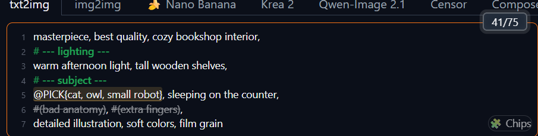

*图：行号、块注释（`# ---` 分段）、行内 `#(...)` 禁用和 `@PICK`。*

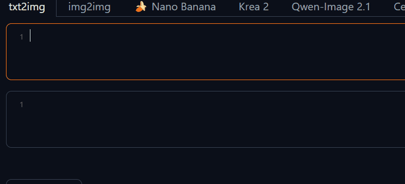

*动图：逐行输入、`# ---` 分段、`@PICK`、行内 `#(...)`、`Ctrl+/` 注释与撤销。*

总之这个TextEditor的改造是我相当满意的改造之一，并且后续潜力无限，尽请期待。

**2. Gallery**

其实就是给我生成的所有图片建一个数据库并带一个画廊系统，我可以给我生成的每张图打分，stage，归档，删除，以及各种快捷操作，比如：
- 将prompt快速填入txt2img，img2img工作区
- 将图片快速传输到inpaint工作区，绘制区等
- 后续又加了相册等功能

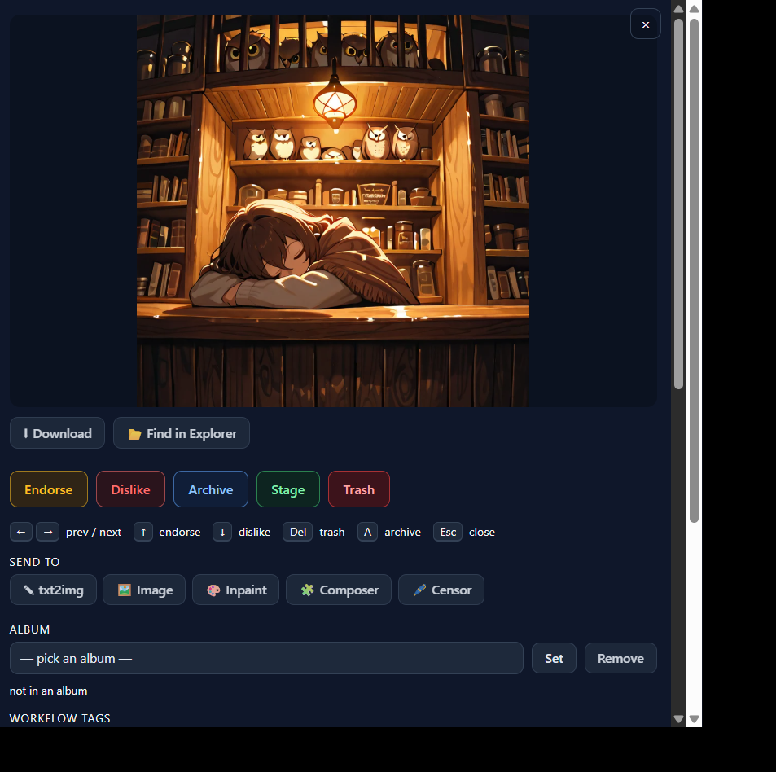

*图：评分、stage、归档、回收站、相册和 send-to 都在详情面板里。*

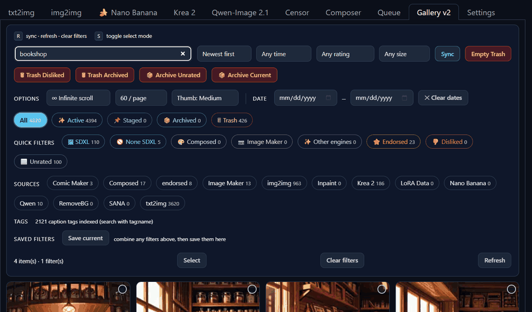

*动图：搜索 → 打开详情 → 送 Composer → 手绘一笔。*

总之，这个功能从一开始的散文件+db（v1）到blob+db（v2）功能经历了多轮迭代，很真实的反映了需求，需求，需求，重构，需求，需求，需求，重构的无尽循环

**3. Composer**

这个功能其实就是一个在webui里内置的画板的功能，让我能不离开webui就能对生成的图片进行细部的修改，然后再继续接入img2img或inpaint。这个功能上是我遇到最多AI给我乱写或者搞砸的部分，主要会经常涉及到一些坐标变换，图像算法，颜色空间啥的一堆毛病。不过还好楼主学的是图形学，不然真让AI忽悠了（当然这是半年前的傻逼DS，现在估计不会给我乱来了）。

总之，现在composer提供了基础的笔刷，线段，取色，图层等功能。还有一些我很喜欢的滤镜，改色等功能。一个很常见的应用场景就是生图中出现的一些瑕疵，我把图片带过来，手动画两笔（比如去掉一根手指），然后再回去inpaint修一下，瞬间搞定，非常高效。

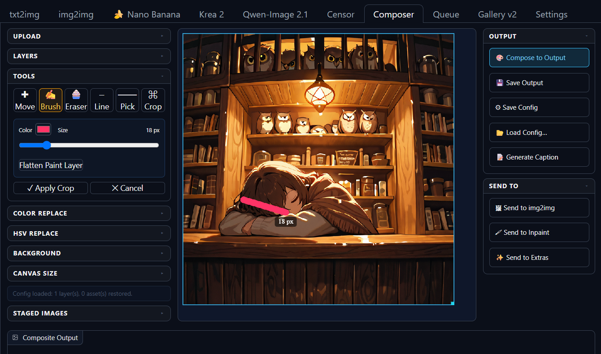

*图：Composer 的笔刷、取色、工具和输出；这里随手画了一笔。*

### 最后的人话

总之，人话部分说到这里。虽然还有很多有意思的功能，留到之后慢慢分享吧。下面的部分是AI写的，不仅更详细，而且有图有真相，有兴趣的可以浏览下：

## AI部分

> 下面这部分由 AI 根据上面的“人话部分”和实际改动整理：尽量不重复原话，重点把需求、取舍和界面串起来。所有截图都来自正在运行的实例，不是设计稿。

先看它现在的样子。

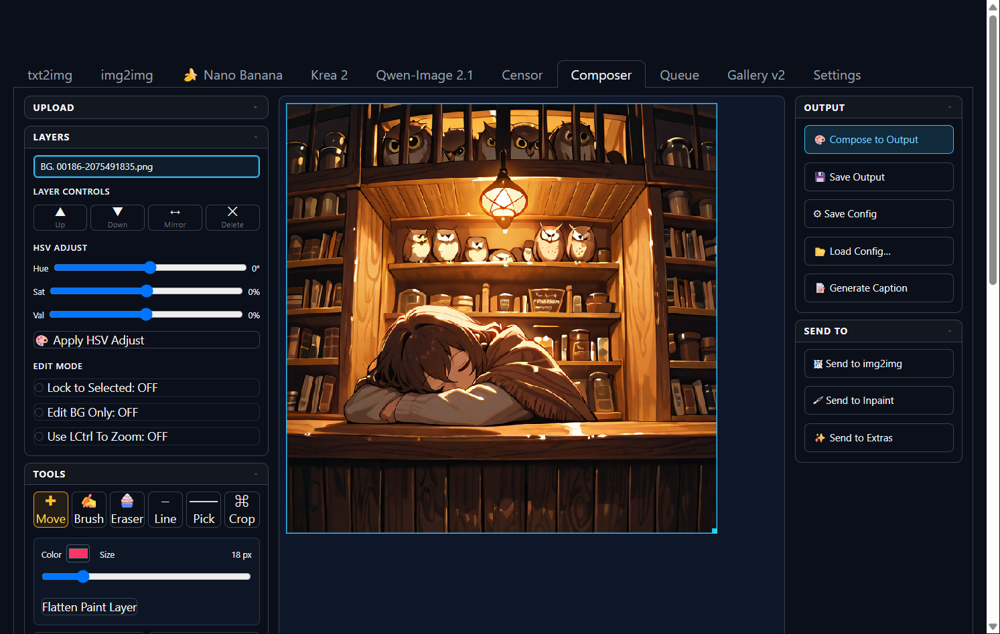

*桌面端的 Composer：左边是图层和工具，中间是画布，右边是输出与发送。顶部那排页签，是这半年长出来的东西。*

## 一、它现在是什么

它不是一个新的 WebUI，也不是一堆插件的拼盘。它是 A1111 v1.10.1 的一个分叉，基线停在 2024 年 7 月，所有改动都在 `dev` 分支上。

从四月底到现在，121 次提交，207 个文件，新增约 6.9 万行（其中一部分是打包进来的第三方前端库）。桌面端现在有十个页签：txt2img、img2img、Nano Banana、Krea 2、Qwen-Image 2.1、Censor、Composer、Queue、Gallery v2、Settings。

但页签数量不是重点。重点是，我不再把它们当成十个功能，而是当成一条流水线上的十段路。

一条图的寿命可以切成四段：

- **说得清**：提示词、预设、注释、随机组；
- **算得出**：SDXL、Qwen、Krea、Gemini、SANA 各自的推理；
- **存得下**：图库、状态、标签、回收站、迁移；
- **用得上**：桌面布局、修图工具、手机端。

下面的四节，就是这四段。

上面提到的 TextEditor、Gallery、Composer，正好落在“说得清”“存得下”“用得上”这三段；“算得出”是把它们接起来的引擎层，而手机端是“用得上”的另一半。

### 为什么是分叉，不是重写

改造最大的风险不是写不出来，是写到一半发现地基不对。所以我先划了三条边界。

**不重写推理内核。** diffusion pipeline、采样器、模型加载、扩展生态，是 A1111 最值钱的部分。重写它意味着从零维护 CUDA 兼容、采样实现、模型格式，收益却几乎为零。我要改的是外面那一圈：输入、输出、调度、边界。

**不追上游。** 基线停在 v1.10.1。分叉的代价很实在：上游每次更新，想拿就得手动挑；上游的节奏和我的需求也不再同步。但收益是——任何一个地方觉得不对，都可以直接改，不用等一个 PR 被 review、被讨论、被无限期搁置。这个分叉的定位从一开始就不是“发行版”，而是“我自己的工作台”。

**不为陌生人做兼容。** 没有安装向导，没有多用户账号体系，没有“通用配置”。默认值就是我的默认值，边界条件就是我的边界条件。听起来很自私，但它让设计简单了一个数量级：不用为想象出来的用户做假设。

也考虑过 ComfyUI。它的心智模型是“搭流程图”，非常适合做实验；但我每天要做的不是实验，是一条重复的流水线：生成、挑图、修图、归档、攒训练集。节点图对“一次实验”很好，对“每天重复十次”是负担。我需要的是一个稳定的工作台，而不是一张每次都要重新检查的图。

所以分叉不是一个技术选型，更像一个“所有权”选择：我愿意为这套工具付维护成本，换来对它每一个细节的决定权。

## 二、说得清：把提示词当文档

SDXL 的输入里，最重要的就是 prompt + negative prompt。但 A1111 的提示词框本质上是一个 textarea：能输入，但没有“行”的概念。不能注释，不能把一组关键词圈起来，也不能在一个 batch 里让每张图随机抽一个词。

这条改造不是一步到位的。最早只是给每张图存一个 `.txt`，解决“这张图用了什么 prompt”；后来把图或 txt 拖进一个下拉框，解决“下次还能不能用”；再后来图库接管了元数据，prompt 不再依附于某个文件；最后才把 textarea 换成编辑器，解决“改起来顺不顺手”。

先能查，再能复用，最后才是好写。这个顺序反过来，很容易做成一个很漂亮但没人用的编辑器。

我把它换成了 CodeMirror 6。第一眼的变化是行号；真正改变用法的是行号带来的几件事：

- 鼠标移到行号上（或按 `Ctrl+/`），可以切换整行、整段（`# ---` 标记之间）的注释；
- 以 `#` 开头的行在进入模型前会被剥掉，所以可以写“这一版为什么这么写”；
- 行内可以用 `#(...)` 做局部禁用（也可以当 inline 注释用），后端会和整行注释一样把它剥掉；
- `@PICK{a, b, c}` 会按种子抽一个词，`@PICK(2){...}` 抽两个；同一个种子能复现同一组词；
- 输入时会从用过的提示词里给建议，省得重新背一遍。

常用的整段风格会存成预设；图库里的 caption 和标签也能反哺建议。

正向和负向两个框用的是同一套编辑器；负向提示词也能注释、分组、复用。

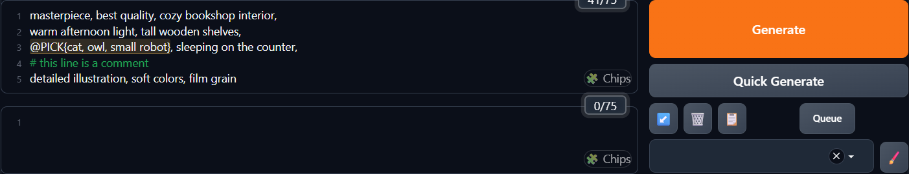

*行号、`@PICK` 随机组、注释行，以及右上角的 token 计数。*

语法写错时，编辑器会标红并在悬停时解释原因，而不是等到出图才发现。移动端把同一份文本渲染成 chips：一个关键词一个块，点按可以调权重、禁用、复制；`@PICK` 会显示成一个带骰子的块。这个后面还会看到。

提示词不是“设置”，它是这套系统里唯一需要长期维护的源代码。把它当文档，才有注释、版本和复用可言。

这块的潜力还远没用完：语法、模板、跨图复用，都还有空间。

这也是我自己最满意的改造之一：它改的不是外观，是每天都要用几十次的那块输入框。

生成结果是这样：

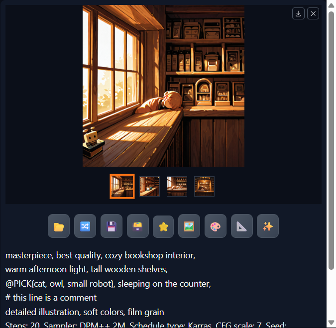

*一次 4 张（768×768，20 步）；右侧是参数、动作按钮和可复制的元数据。*

结果面板右侧不是装饰：参数、种子、模型哈希、耗时都在，可以直接复制回提示词，也可以把这张图送到 img2img、inpaint、Composer 或 Censor。图不再是一个“文件”，而是一个带着上下文的条目。

## 三、算得出：引擎是服务，不是插件

上面说的 TextEditor 解决“输入”，Gallery 解决“输出”；中间这段是“算”，也是这半年改动里最像搭积木的一段。

模型世界已经分裂。SDXL 是一套 pipeline，Qwen-Image 2.1 是 GGUF DiT，Krea 2 是 12B MMDiT 加另一套文本编码器和 VAE，SANA 又是另一种结构，Gemini 干脆在远端。A1111 只认识它自己那一套。

一开始我也想“都接进来”。结果是每接一个，核心就被改一次；引擎的依赖、崩溃和升级，全都变成核心的一部分。

后来改成 sidecar：每个本地引擎自己起进程、自己管端口、自己吃显存，WebUI 只做入口、生命周期和编排。Krea 2 和 Qwen 的页签顶部都是同一组按钮——Start / Stop / Restart / Refresh——但按下去的是两个完全不同的进程。

接一个新引擎，实际上是三件事：一个进程管理模块、一个页签、一条图库来源注册。三件事都在边缘，不动核心。

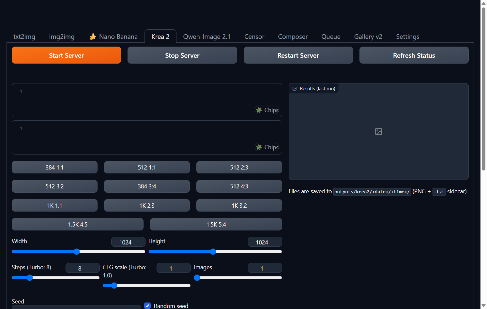

*Krea 2：sidecar 生命周期、提示词、分辨率预设和结果区。*

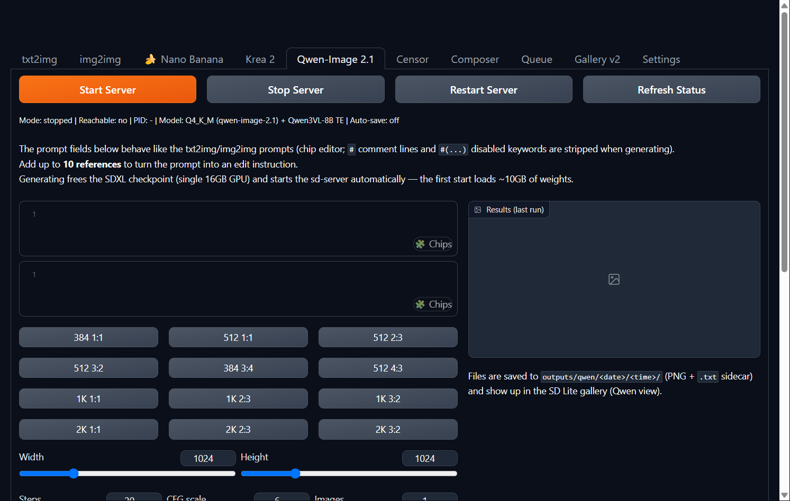

*Qwen-Image 2.1：同一套外壳，不同的引擎和参数。*

Gemini 系列没有本地进程，直接走远程 API；单图、Image Maker、Comic Maker、LoRA Data Maker 四条路径共用同一个入口。

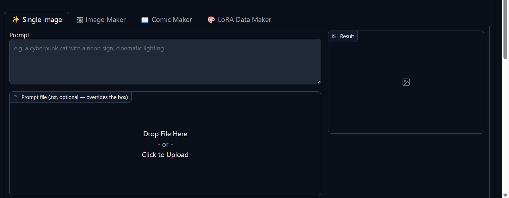

*Nano Banana：单图、Image Maker、Comic Maker、LoRA Data Maker 四条路径。*

还有一层不显眼但很重要的东西：队列。生成、重排、暂停、恢复、清理都在这里；单卡机器上，它决定了你是在“等图”还是在“被图等”。

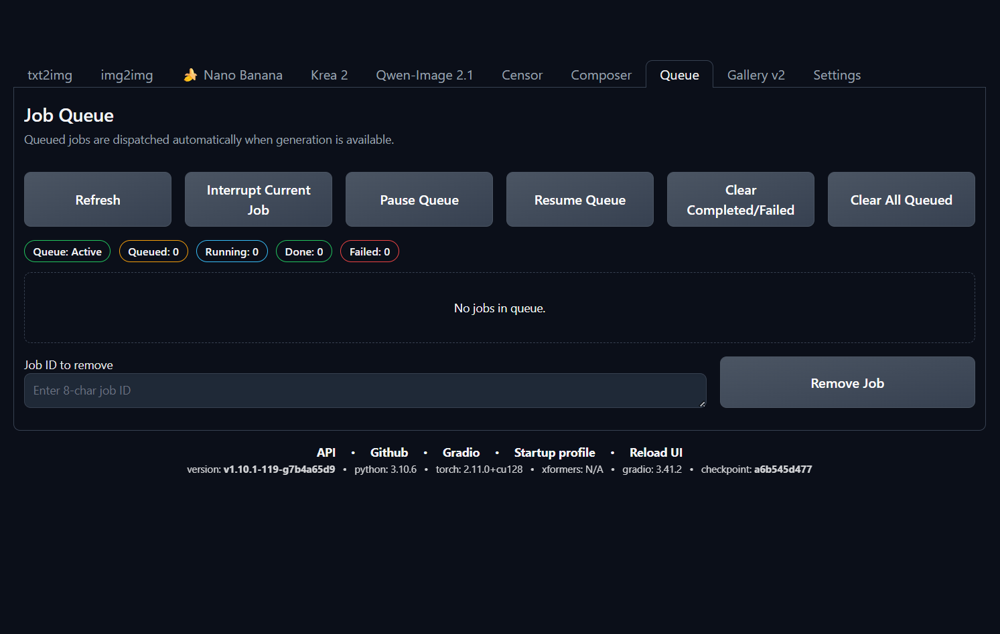

*Job Queue：暂停、恢复、重排、清理，以及当前运行状态。*

单卡上的 sidecar 不是免费的：启一个引擎要几十秒、十几 GB 权重，生成前还要把 SDXL 的 checkpoint 让出去。所以 UI 里才有“开始/停止/刷新”，队列里才有暂停和重排——这些不是运维按钮，它们就是工作流的一部分。

核心想法是：**控制面和数据面分开。** WebUI 不需要会跑所有模型，它只需要知道怎么把任务交给会跑的人；用户看到的是同一个入口、同一套图库、同一种参数语言，但入口后面是谁在算，不必统一。

## 四、存得下：文件系统不是数据库

这是最大的一块，也是最难回头的一块。

用久了之后，`outputs/` 已经变成了事实上的数据库：日期文件夹当索引，同名 `.txt` 当元数据，缓存 webp 当缩略图，收藏副本当“重要”标记，回收站靠旧数据库里的一行记录。查询靠遍历，删除靠记忆。

Gallery 也不是一步到位的。v1 是“散文件 + DB”：文件还在 `outputs/`，DB 只记路径、评分和状态。它能解决“找得到”，但每次查询还是要回文件系统，删除也要手动清 sidecar 和缓存。v2 才把元数据和媒体都收进权威库 + blob 存储。

清理前的账大概是：74,092 个散落文件；39,608 个 `.txt` sidecar，其中约 3.5 万个是已经删掉的图留下的孤儿；3,976 个收藏副本，8.54 GB 像素级重复；20,564 个缓存 webp；1,169 个 composer 状态文件。

Gallery v2 把这件事翻了过来：

- 一个权威数据库（items / sources / tags / state / FTS）；
- 一个 blob 存储：缩略图和预览图按 item 存，不再散在目录里；
- 一张来源注册表：新增一个引擎 = 一行注册 + 一个解析器；
- 一个状态机：active / staged / archived / trashed，普通归档 24 小时后进入回收站，收藏项有保护；
- 一套搜索语法：`tag:`、`rating:`、`source:`、`prompt:`、`-exclude`、`"phrase"`。

评分、stage、归档、回收站、相册、send-to 都在详情抽屉里；它们不是装饰，是把“挑图”这件事从记忆变成状态。人话部分说的“prompt 快速填入 txt2img/img2img”“图片传到 inpaint/绘制区”，走的就是这里的 send-to。

删除是这一层最容易被低估的功能。删一张图，不应该靠记忆去删它的 sidecar、缓存和收藏副本；状态机把“归档”“回收站”“彻底删除”分开，清理交给 TTL 和后台 sweeper。删除有了语义，人才敢真的删。

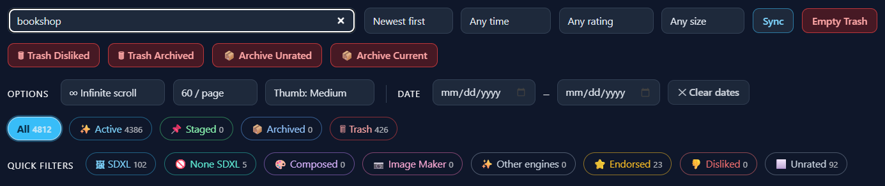

*图库的筛选区：搜索、排序、时间、评分、尺寸、批量操作、状态计数和快捷筛选。*

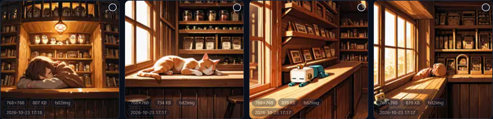

*卡片直接给尺寸、体积、来源和时间；缩略图来自 blob 存储。*

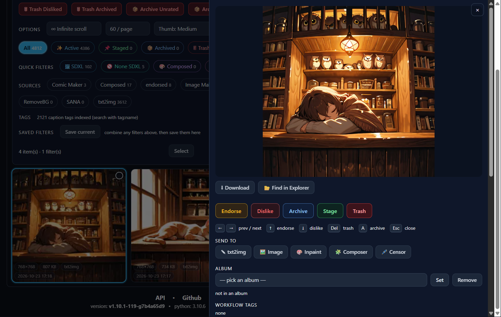

*详情抽屉：预览、评分/状态、发送到、专辑、标签。*

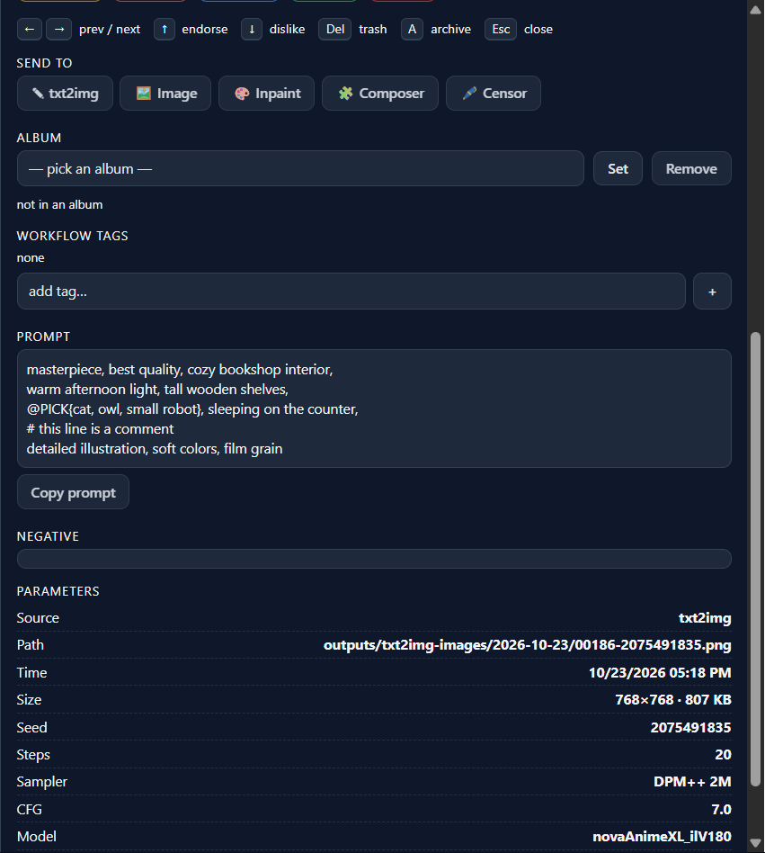

*再往下是提示词、参数、路径和种子。*

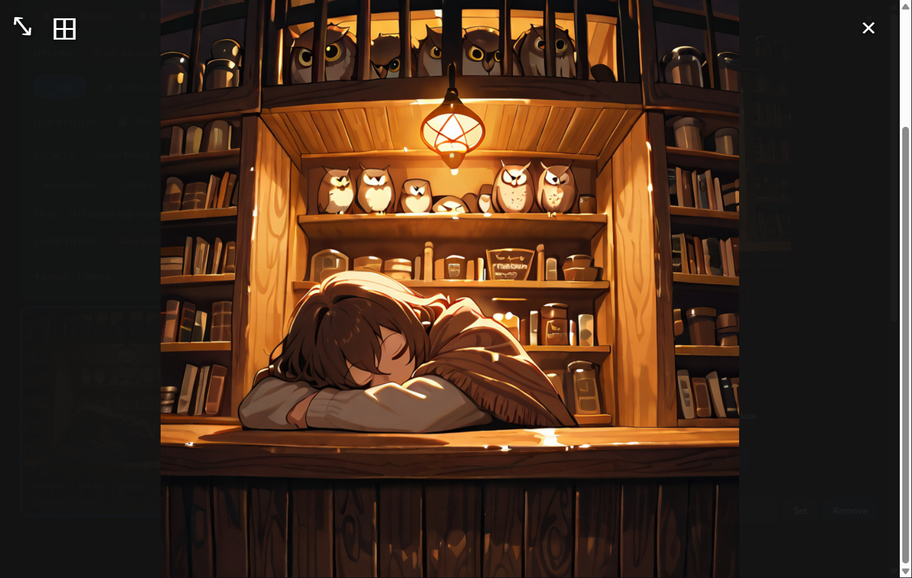

*全屏查看器：缩放、平铺、对比、保存、上一张/下一张。*

说明一下：为了不把私人图库带进文章，这四张演示图是专门生成的；上面的图库截图都来自同一组图。搜索 `bookshop` 只返回这四张，所以画面很干净。

迁移比写新代码难。四万条旧记录、三万五千条回收站数据、三万七千个 sidecar、8.5 GB 重复副本、两千多个孤儿 json/txt——新代码可以推倒重来，旧数据不能。最后的做法是：先快照，再分阶段导入，然后双写观察，设验收门，留回滚开关。

迁移时一共 41,907 条记录，大部分是历史回收站；清理后活跃约 4,400 条、回收站 426 条（合计约 4,820 条），来自 11 种来源。缩略图覆盖率 100%，收藏副本改成硬链接释放 8.37 GB，散落文件从 74,092 降到约 26,560。

这次迁移没有“一刀切”。旧库继续双写，新库先只读；验收门过了才切读，环境变量随时能退回。迁移不是一次性脚本，而是一段时间内的双轨运行：旧路径还在，心里就不慌。

核心想法是：**文件是文件的归宿，数据是数据的归宿。**

这半年最真实的节奏不是“设计→实现”，而是“需求→能用→发现新需求→再重构”。Gallery 走了 v1→v2，Composer 也回炉过；这不是返工，是需求长出来的样子。

## 五、用得上：界面是工作流的一部分

桌面端现在有三件“把图改完”的工具，它们解决的是同一个问题：不要为了修一张图，把图导出到另一个软件，再导回来。

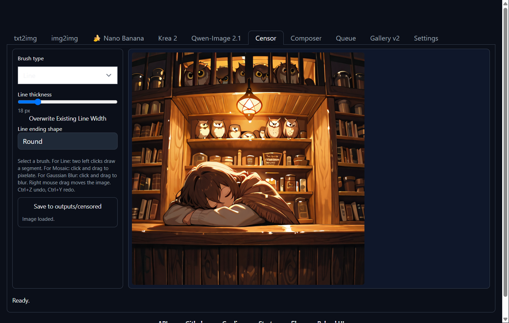

*Censor：线、马赛克、高斯模糊三种笔刷，适合做遮挡和局部处理。*

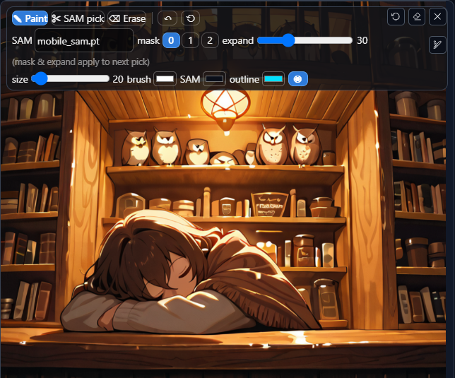

*Inpaint：SAM 点选 + 画笔/橡皮 + 遮罩扩展，画布上直接改。*

Composer 是另一条路：笔刷、线段、取色、图层、裁剪、滤镜、HSV/颜色替换，最后直接保存到 `outputs/composition`，或者送回 img2img / inpaint。上面第一张图就是 Composer。

最典型的使用场景就是人话部分说的：图里多了一根手指，先带进 Composer，用画笔/取色/图层盖掉，再送回 inpaint 修边缘；整个过程不离开 WebUI。

把修图留在生成工具里，不是为了少开一个软件，而是为了不丢上下文：图、参数、种子、来源都在同一个条目上，改完还能回到图库，下一次生成还能接着用。导出到 Photoshop 再导回来，丢掉的往往不是画质，而是这张图为什么长这样。

移动端不是在 Gradio 页面上打补丁。Gradio 页面本身有几 MB、几千个节点，手机上第一步就输了。Mobile Lite 是一个独立前端：几十 KB、没有框架、没有构建步骤，通过一组小 JSON 接口复用后端现成的处理管线。

入口在设置里：

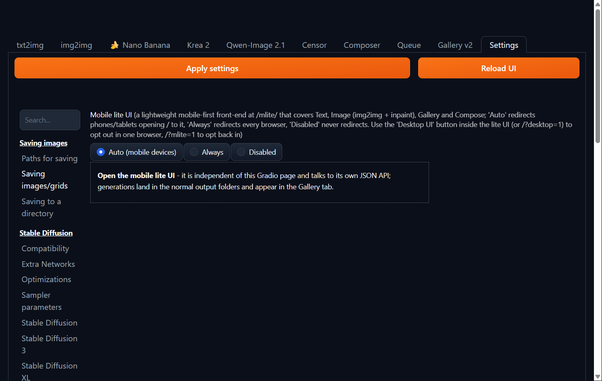

*Auto 会在手机/平板打开 `/` 时跳转到 `/mlite/`；Always 全部跳转；Disabled 关闭。*

它有六个屏幕：Text、Image、Krea 2、Qwen、Gallery、Compose。

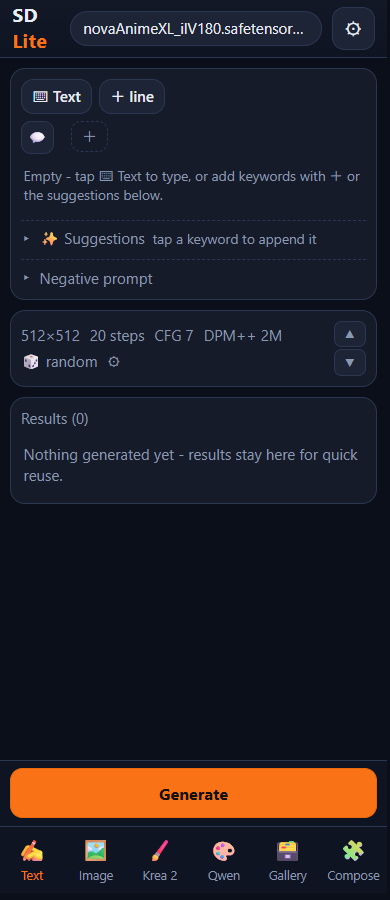

*Text：提示词、参数快照、结果区和底部导航。*

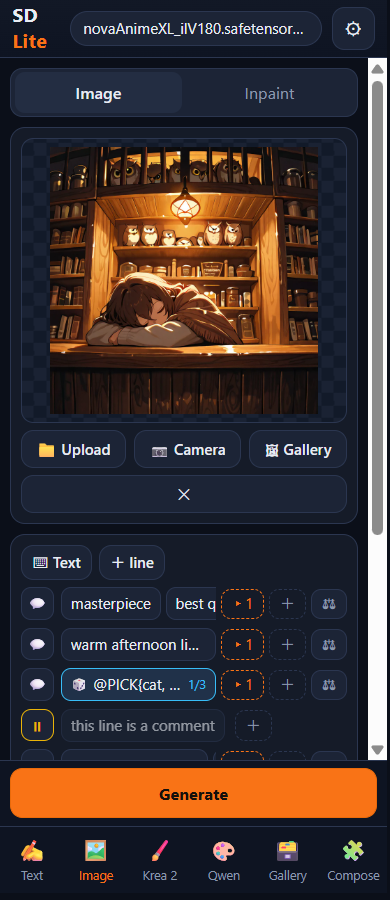

*Image：从图库带过来的图，提示词仍然是同一套 chips 语法。*

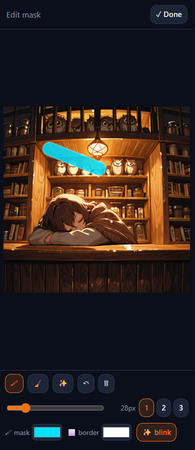

*Inpaint：画笔、橡皮、SAM、笔刷大小和颜色，直接在手机上画遮罩。*

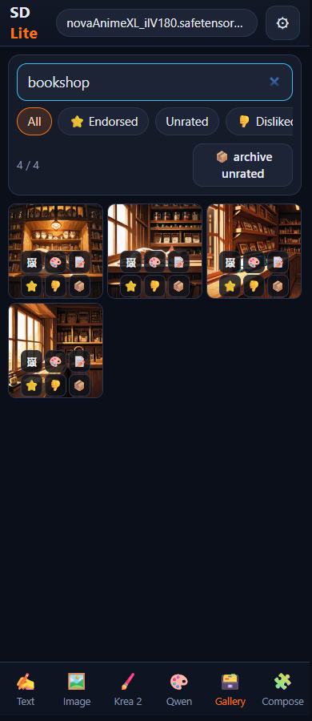

*Gallery：搜索、状态筛选、批量操作、快速发送。*

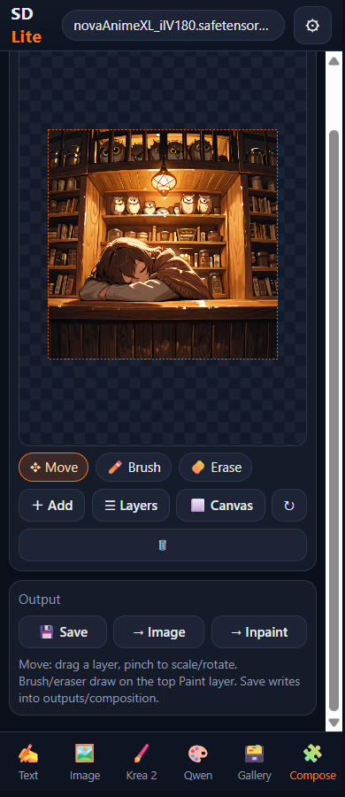

*Compose：图层、移动/画笔/橡皮，保存或送回 Image/Inpaint。*

Mobile Lite 不是另一套后端：生成仍然走同一个处理管线，文件落在同一个 `outputs/`，图库也能看到。它只是换了一个更轻的入口。

核心想法是：**前端不是后端的投影。** 手机有自己的约束和节奏；它不需要把桌面端的所有东西缩小，只需要把高频路径做顺。

## 六、代价与现状

这套东西现在每天在用，但它不是产品。

- 没有安装向导，没有多用户账号体系，没有“通用配置”；
- 只有一个 16GB GPU，sidecar 之间要互相让显存；
- 迁移还在观察期，有些边角数据的字段还没搬完；
- 有些页面在极端尺寸下还会挤，UI 的坑是排完一个又来一个。

一个人维护分叉，我给自己定了三条规矩：

1. **每天真的用它。** 摩擦比需求文档诚实。
2. **每次只换一块地基。** 旧页面、旧库、旧路径都留着；任何改动都有一个能退回去的开关。
3. **接受它不完美。** 主路径每天在跑，边角就可以排队。

人话部分提到 Composer 是 AI 最容易写坏的地方，我同意。坐标变换、颜色空间、图层合成，这些地方“看起来对了”和“真的对了”差得很远。我的办法很笨：每个改动都当天用、当天回退；能用眼睛验证的，绝不只信日志。AI 可以很快搭出 80%，剩下的 20% 往往就是这些边界条件。

分叉的代价也很具体：上游每次更新，想拿就得手动挑；有些改动会和新版本冲突；没有测试团队，回归只能靠每天用。这套东西能走到今天，靠的不是某个设计多聪明，而是它每天都在被使用、被嫌弃、被修一点。

## 七、如果把它压成一张清单

- 输入：CodeMirror 提示词、行号/行内/块注释、`@PICK`、输入建议、预设、样式；
- 生成：txt2img、img2img、inpaint、hires/stages、批量、种子；
- 引擎：SDXL、Qwen-Image 2.1、Krea 2、Nano Banana（Gemini）、SANA、rembg；
- 数据：Gallery v1→v2、prompt 缓存/复用、评分/stage/归档/回收站、相册、send-to、筛选/搜索、查看器、迁移；
- 编辑：Composer（笔刷/线段/取色/图层/滤镜/改色）、Censor、Inpaint/SAM、对比；
- 调度：Job Queue、全局进度、显存/进程管理；
- 终端：Mobile Lite 六个屏幕 + 桌面十页签。

它不是“功能更多了”，而是这些功能终于在同一条流水线上。

## 八、接下来

接下来还会继续打磨：图库的边角数据、手机端的细节、提示词编辑器的可用性。这个分叉不会变成发行版，但它会越来越像“我自己的工具”。

这篇先把主干的四段讲清楚；人话部分提到的那些小功能——拖拽填 prompt、评分、滤镜、改色——正文里已经带到，这里就不继续展开了，以后有机会再拆。

工具的价值不在于功能多，而在于你愿不愿意每天打开它。
